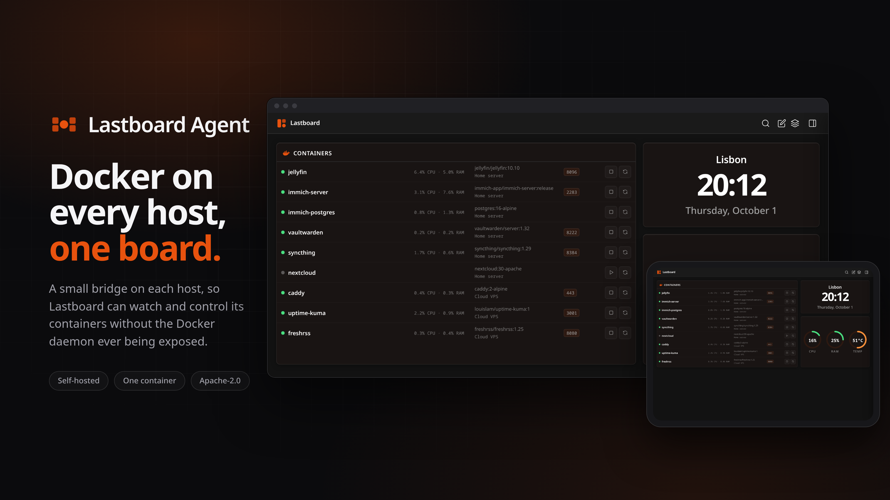

<div align="center">
  <br />
  
  <br /><br />

  <h1>Lastboard Agent</h1>
  <p><strong>Secure Docker bridge for Lastboard — monitor and control remote containers without exposing the Docker daemon.</strong></p>

  <p>
    <a href="https://codigosh.com/docs/lastboard/widgets/docker/">
      
    </a>
    &nbsp;
    
    &nbsp;
    
  </p>

  <br />

  

  <br /><br />

</div>

---

<div align="center">


</div>

---

📖 **[Read the Docker widget guide](https://codigosh.com/docs/lastboard/widgets/docker/)** for the Lastboard side: adding hosts, choosing containers and what each row shows. This README covers the agent itself.

---

## Why Lastboard Agent

Watching the containers of another machine from a dashboard usually means exposing that machine's Docker daemon over TCP, and the Docker API is the keys to the host: whoever can reach it can start a privileged container and own the machine. The agent was built with a simple rule: **Lastboard gets exactly the five calls it uses, and nothing else reaches Docker.**

It runs next to Docker on the remote host, reads the local socket, and answers Lastboard over HTTP with a token on every request. No database, no configuration files and no state: restart or replace it at any time.

| | |
| :--- | :--- |
| **Shape** | A small container image for `linux/amd64` and `linux/arm64` |
| **Storage** | None. Fully stateless |
| **Setup** | One environment variable: `TOKEN` |
| **Talks to** | The local Docker socket, and nothing else |
| **Dependencies** | None beyond the Go standard library |
| **Licence** | Apache-2.0 |
| **Telemetry** | None. Ever |

---

## Features

### What Lastboard can do through it

- **List every container** on the host, running or stopped, with its image, state and published ports.
- **Read CPU and memory** for each one.
- **Start, stop and restart** a container from its row in the dashboard.
- **Many hosts, one widget**: put an agent on each machine and Lastboard lists them together, each row naming where it runs.

### What it refuses

- **Anything that is not one of those five calls is refused**, even with a valid token — `404`, or `405` for a known path asked with the wrong method: no creating, deleting or `exec`-ing into containers, no images, no volumes, no networks.
- **Query parameters are allowlisted too.** Only `all` reaches the list, stats are always a single reading, and start, stop and restart take none — so a leaked token cannot hold a stats stream open, make the daemon size every container on disk, or stop one with a timeout of days.
- **A container ID that is not a plausible ID or name** stops at the agent with `400`, before anything reaches the socket.

### Operations

- **`/health`**, public, reports that the agent is serving and which version it is. The image uses it as its Docker `HEALTHCHECK`.
- **A warning at startup** when the token is shorter than 32 characters or is one of the example values from the documentation.

---

## Security & Privacy

### Security

The token is compared in constant time, and on every route but `/health` a request without the right one gets `401` whatever it asks for, so an unauthenticated caller cannot tell which routes exist. After the check, the token is removed from the request: Docker never sees it. The five calls are the whole surface a leaked token gives away — list and control the lifecycle of existing containers, never compromise the host.

That limit is the agent's allowlist, not the mount: `:ro` on a Unix socket stops nothing from being written through it. It is in the examples as good practice, not as the protection.

- Restrict the agent's port in your firewall to the Lastboard host.
- The agent runs as `root` inside the container so it can read the Docker socket. To run it unprivileged, grant only the host's `docker` group with `group_add` (see [docker-compose.yml](docker-compose.yml)).

### Privacy

The agent stores nothing and sends nothing anywhere. It keeps no record of requests: its log carries its startup lines, the token warning when there is one, and a line when it cannot reach Docker.

---

## Installation Methods

Docker on the remote host, and the agent's port (`2375` by default) reachable from the Lastboard host.

### Quick Start with Docker

Copy the following `docker-compose.yml` to the remote host:

```yaml
services:
  lastboard-agent:
    image: git.codigosh.com/codigosh/lastboard-agent:latest
    container_name: lastboard-agent
    ports:
      - "2375:2375"
    environment:
      - TOKEN=change-this-to-a-secret-token
    volumes:
      - /var/run/docker.sock:/var/run/docker.sock:ro
    restart: unless-stopped
```

Three things to know before running:

- **`TOKEN`** — the shared secret Lastboard will use to authenticate. Generate a strong one:
  ```bash
  openssl rand -hex 32
  ```
- **`ports`** — change `2375:2375` if you need a different port. The right side must match `PORT` if you override it.
- **`volumes`** — `/var/run/docker.sock` must not be changed. This gives the agent access to the local Docker daemon.

Then start it:

```bash
docker compose up -d
```

Without Compose, the same thing in one command:

```bash
docker run -d --name lastboard-agent --restart unless-stopped -p 2375:2375 \
  -e TOKEN=your-secret-token \
  -v /var/run/docker.sock:/var/run/docker.sock:ro \
  git.codigosh.com/codigosh/lastboard-agent:latest
```

### Configuration

| Variable | Default | Description |
| :--- | :--- | :--- |
| `TOKEN` | *(required)* | Bearer token for authentication. Use a strong random value. |
| `PORT` | `2375` | Port the agent listens on. |
| `SOCKET_PATH` | `/var/run/docker.sock` | Path to the Docker Unix socket. |

---

## Connecting to Lastboard

1. In Lastboard, enter edit mode and add a **Docker** widget, or open the settings of an existing one.
2. Click **Add New Host**.
3. Give it a **Name**, and choose **Lastboard Agent** as its **Type**.
4. In **Host URL**, enter the host and port: `your-server-ip:2375`.
5. In **Token**, enter the token you chose.
6. **Save** the host, then **Save** the widget. The host's containers appear in the list.

---

## Updates

The agent has no updater of its own. With the container, pull the new image and recreate it:

```bash
docker compose pull && docker compose up -d
```

The image comes straight from our own registry — no proxy and no intermediary — and what each version changes is on the [releases page](https://git.codigosh.com/CodigoSH/lastboard-agent/releases).

---

## Build

Requires [Go](https://go.dev) 1.27.1 or newer.

```bash
go build -o lastboard-agent .     # the agent
go test ./...                     # the allowlist, the token and the pins
```

A build from source reports its version as `dev`; the image reports its release tag.

The image at the top of this file is composed by `bun scripts/docs-mockup.ts`, with [Bun](https://bun.sh) and a Lastboard checkout beside this one (or `LASTBOARD=/path/to/it`). The two hosts in it are invented: the script serves a small Docker API on two sockets and points two agents built from this repository at them.

---

## Support & Recognition

We are an open-source initiative managed through [Open Collective Europe](https://opencollective.com/codigosh).

### Financial Support
If you find our tools useful, consider supporting our infrastructure through an unconditional donation.

[](https://opencollective.com/codigosh)

### Acknowledgments
Special thanks to everyone supporting our mission. 
<a href="https://opencollective.com/codigosh">
  
</a>

### Organizations
We appreciate the organizations that support us as a gesture of goodwill to help maintain our infrastructure.
<a href="https://opencollective.com/codigosh">
  
</a>

---

## Credits

- **Everything here is written in this repository**: the agent uses only the Go standard library, and the mark is drawn by hand in [assets/logo.svg](assets/logo.svg).

Full attribution lives in [NOTICE](NOTICE).

---

A project by [CodigoSH](https://git.codigosh.com/CodigoSH) — built to last.
