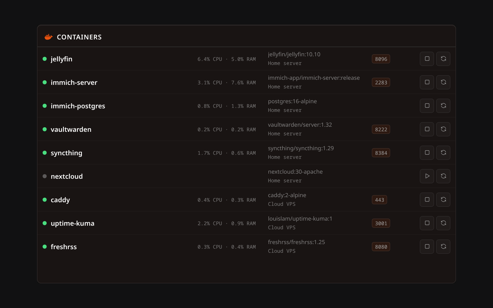

# Lastboard Agent Documentation

Lastboard Agent is a small bridge you run next to Docker on another host, so Lastboard can list its containers, read their CPU, memory, details and logs, and start, stop or restart them — without the Docker daemon ever being exposed to the network.



## How it fits

```
Lastboard  ── HTTP, bearer token ──▶  Lastboard Agent  ── Unix socket ──▶  Docker
your dashboard                        port 2375, one variable             stays private
```

Exposing a machine's Docker API over TCP hands the keys to that machine to anyone who can reach the port: they can start a privileged container and own it. The agent exists so you never have to. It sits on the remote host, reads the local Docker socket, and answers Lastboard over HTTP with a token on every request.

It is not a general proxy. It is an **allowlist of seven calls**: list containers, read one container's stats, details or logs, and start, stop or restart one. The details leave without the values of the environment variables. Anything else is refused, even with a valid token.

It stores nothing and has no configuration files. One environment variable, `TOKEN`, is all it needs, and you can restart or replace it at any time.

## Where to start

- **[Installation](getting-started/installation.md)** — the compose file, the one-line `docker run`, the image tags, and how to run it without root.
- **[API reference](reference/api.md)** — the seven calls, what is dropped from the query string, every status code, and what a leaked token can and cannot do.
- **[Troubleshooting](help/troubleshooting.md)** — what you see when something is wrong, and what causes it.

The other half of the setup lives in Lastboard: adding a host to the Docker widget is covered in the [Docker widget guide](/docs/lastboard/widgets/docker/).

## What it does not do

- **It does not encrypt.** The agent speaks plain HTTP. Keep it on a network you trust, or put it behind a reverse proxy that terminates TLS.
- **It does not log requests.** Its log carries its startup lines, a warning about a weak token when there is one, and a line when it cannot reach Docker.
- **It does not update itself.** The agent is distributed as a container image: pull the new image and recreate the container.
- **It does not send anything anywhere.** No telemetry, no third parties.

The source and the releases are at [git.codigosh.com/CodigoSH/lastboard-agent](https://git.codigosh.com/CodigoSH/lastboard-agent). Questions and bug reports go to the [support page](https://support.codigosh.com/codigosh/lastboard-agent); a vulnerability follows the [security policy](https://git.codigosh.com/CodigoSH/lastboard-agent/src/branch/main/SECURITY.md).
